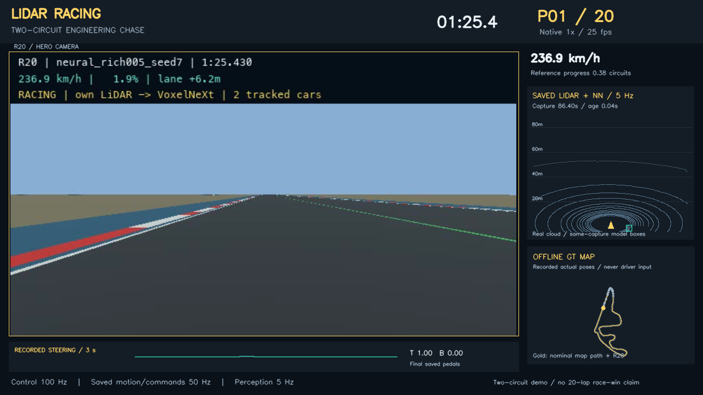

# LiDAR Racing

LiDAR perception and hybrid autonomous racing in Webots. A CMPE249 project by
Bradley Yong, developed with AI coding assistance.

[](docs/LiDAR_Racing_Qualified_Highlight.mp4)

[Watch the two-minute demo](docs/LiDAR_Racing_Qualified_Highlight.mp4) ·
[Complete flying lap at 1x](docs/LiDAR_Racing_Full_Flying_Lap_1x.mp4) ·
[Updated presentation](docs/Presentation_Update.pdf) ·
[Measured results and source](experiments/local-optimization/README.md)

The simulator runs wheel physics and LiDAR on a Mac, with VoxelNeXt inference
on NVIDIA GPUs. A supervised neural driver works with tracking, a supplied map,
and conventional planning/control guards on an approximate Yas Marina course.
See the [system architecture](docs/architecture.md) for the actual data flow.

## What to review

| Material | What it establishes |
| --- | --- |
| [Final report](docs/report.pdf) and [73-case study](docs/final_study.md) | Controlled detector/driving experiments and a balanced four-policy championship. |
| [Latest engineering demo and comparison](experiments/local-optimization/README.md) | A qualified two-circuit chase, six matched traffic runs, exact source and motion tradeoffs. |
| [CPU reproductions](reproduction/README.md) | Saved-prediction matching/counts that run without a GPU or simulator. |
| [Saved motion ablation](reproduction/control-cadence/README.md) | Recomputable pace, motion and compute tradeoffs from three solo recordings. |
| [Updated presentation](docs/Presentation_Update.pdf) and [speaker cues](docs/Presentation_Update_Notes.md) | Twelve slides; the ten-minute plan includes the two-minute native demo. |
| [Original presentation](docs/presentation.pdf) and [matching recording](docs/LiDAR_Racing_Demo.mp4) | The retained course deck and its original linked chase video. |

**Study finding:** higher offline detector recall did not guarantee better
driving. The neural finalist was 3.74% slower by paired median and was not
promoted; Reference ranked first across four balanced 20-car championship heats.
All 80 championship entries finished clean. See the [study results](docs/final_study.md)
and [original study demo](docs/demo.mp4).

**Instructor follow-up:** a score-swept BEV IoU 0.5 AP101 analysis on the same
known simulated development set is [reproducible from saved predictions](reproduction/controlled-bev-ap/README.md).
The original model scores 81.56% and the best full-network fit scores 97.67%;
these are fixed-postprocessing DEV results, not official benchmark scores.

**Latest demo:** R20 starts last, first appears in P1 at 85.4 simulated seconds,
and closes after two reference circuits. Its flying circuit takes **172.390 s**;
the full native lap is available above. All 20 cars remain active with zero
native overlap, wheel-rule, inward-patch or reset counts.

**Measured tradeoff:** at 100 Hz control, the faster profile lowers mean first-
reference crossing time by **4.14%** across three repeats per arm, with the same
14/18 mean planned-target accuracy. Steering variation and several body-motion
measures increase. The [complete results](experiments/local-optimization/README.md)
retain every repeat, negative result and a disclosed legacy timestep-label mismatch.

This is an engineering chase with supplied pose/map, original learned models,
an approximate circuit and custom geometry audits. The inherited scene removes
206 decorative posts, and the enhanced hero has a 100 m/s software limit versus
60 m/s for base rivals with different policies. P1 does not establish a fair
model ranking or a completed 20-lap race.

## Run the portable checks

Use Python 3.11. The cached recipes were verified with NumPy 1.26.4, SciPy
1.16.2 and Shapely 2.1.2. Run from the repository root into fresh output directories:

```sh
python3.11 -m venv .venv
.venv/bin/python -m pip install -e '.[test,reproduction]'
.venv/bin/python -m race_lidar doctor
.venv/bin/python -m pytest -q
.venv/bin/python -m race_lidar demo --output runs/cpu-demo --frames 20
.venv/bin/python scripts/evaluate_cached_qualification.py --output runs/qualification.json
.venv/bin/python -I reproduction/controlled-native/reproduce.py --output runs/native.json
.venv/bin/python reproduction/controlled-bev-ap/reproduce.py --output runs/bev-ap.json
.venv/bin/python -I reproduction/controlled-rotation/reproduce.py --output runs/rotation.json
.venv/bin/python -I reproduction/control-cadence/reproduce.py --output-dir runs/control-cadence
```

See the [local verification record](docs/verification.md) for CPU tests,
installed-wheel checks and the prepared CI workflow.

The synthetic demo uses geometric clustering. Cached comparisons recompute
metrics on 8,955 qualification frames, 6,144 native development frames and a
512-frame rotation diagnostic; they do not run a learned detector.

Live inference, detector training and physical races require external weights,
reference data, Webots and a compatible CUDA environment. Those downloads are
not hosted with this source checkout. Follow [setup](docs/setup.md) and the
[artifact catalog](artifacts/README.md).

## Repository guide

| Location | Contents |
| --- | --- |
| [src/race_lidar](src/race_lidar) and [webots](webots) | Base-study perception, driving, control and simulation code. |
| [scripts](scripts/README.md) and [training](training/README.md) | Entry-point catalog, preparation, training and evaluation tools. |
| [tests](tests) | Portable regression tests and retained campaign checks. |
| [reproduction](reproduction/README.md) and [examples](examples) | Compact CPU evidence and measured/synthetic fixtures. |
| [experiments](experiments/README.md) | Engineering extensions, exact source overlays, ablations and negative results. |
| [docs](docs/README.md) | Report, presentation, setup, study records and demo navigation. |
| [research](research/rich006/README.md) | Frozen historical teacher/fitter source for audit. |

The installed base source and the latest experimental overlay are distinct.
Use the [latest apply-order recipe](experiments/local-optimization/APPLY_OVERLAY.md)
to reconstruct its exact source; combining arbitrary snapshots will not do so.
Earlier large media and generated working files are preserved in a verified
local archive. The [archive catalog](docs/archive.md) records their identities
and restoration instructions; source/evidence receipts remain in the repo.

This is a simulation study with supplied ego localization/map and custom
matching/track rules. It does not claim real F1 performance, official benchmark
AP, or reinforcement learning. RGB is recorded for viewing; opponent truth is
used for offline labels/scoring and is excluded from driver control.

See [contributions](CONTRIBUTIONS.md), [source provenance](docs/provenance/README.md)
and [third-party notices](NOTICE.md). Project code uses the [MIT license](LICENSE);
external assets and dependencies retain their own terms.
