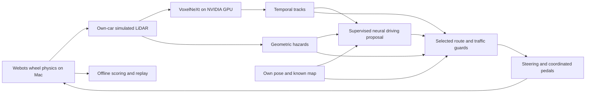

# System architecture

LiDAR Racing combines a learned LiDAR detector and supervised driving policy with
map-aware planning, tracking and conventional control. It uses supplied own-car
localization and a known approximate course. RGB is recorded for viewing and is
not the input to the racing detector.

## What each stage does

| Stage | Role | Source to start with |
| --- | --- | --- |
| Sensor/transport | Record measured point arrays and send the current cloud to the inference endpoint. | [I/O](../src/race_lidar/io.py), [remote inference](../src/race_lidar/remote.py). |
| Learned perception | Run the pinned upstream VoxelNeXt checkpoint in a compatible CUDA environment. | [Server entry point](../scripts/serve_exported_detector.py), [inference adapter](../training/inference.py). |
| Tracking/hazards | Preserve temporal evidence and geometric obstacle information for control. | [LiDAR hazards](../src/race_lidar/lidar_hazards.py). |
| Learned driver | Propose driving intent from measured observations and supplied map/ego state. | [Supervised driver](../src/race_lidar/rich_driver.py), [policy](../src/race_lidar/race_policy.py). |
| Conventional planning/control | Select a feasible route, respect traffic and braking constraints, then command wheel steering/pedals. | [Base control](../src/race_lidar/race_control.py), [hotlap driver](../src/race_lidar/hotlap_driver.py), [latest overlays](../experiments/apex-tracking/APPLY_OVERLAY.md). |
| Evaluation | Score saved outputs, audit native overlap/road limits and construct replay views. | [Race results](../src/race_lidar/race_results.py), [cached reproduction](../reproduction/README.md). |

The neural policy does not directly bypass traffic guards or vehicle actuation
limits. Later engineering extensions add a frozen nominal racing line, passing
rules, predicted measured-traffic motion and brake coordination around the
original learned weights. Their source is retained as explicit overlays rather
than silently replacing the completed-study snapshot.

## Observation and scoring boundaries

- The driver receives its own simulated LiDAR, own pose/velocity and a known map.
- Opponent ground-truth positions/boxes are reserved for offline labels, scoring
  and clearly labeled replay displays. They are excluded from driver control.
- Saved future traffic curves are predictions from measured tracks, not future
  actual opponent positions. Prediction plots do not establish calibrated or
  beneficial control by themselves.
- The included CPU reproductions evaluate cached predictions and labels; they
  do not invoke the detector or reproduce vehicle physics.

The latest selected demo records LiDAR/model decisions at 5 Hz, physical
commands/body telemetry at 50 Hz, and the native camera at 25 fps. These rates
serve different purposes. A higher viewing cadence does not establish smoother
physical motion or hard real-time performance.

The [completed study](final_study.md) compares policies under its declared
protocol. The [latest chase](../experiments/apex-tracking/README.md) is a separate
engineering demonstration with an enhanced hero and explicit scene change.
Both use simulation/custom metrics and supplied localization; neither
establishes real-world F1 or official autonomous-racing benchmark performance.
