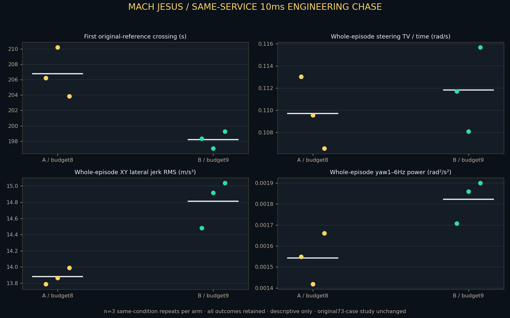

# Control cadence and pace

Six 20-car chases compared two cornering budgets at 100 Hz control with the same original detector, learned drivers, car and road assets. The faster profile reduced the mean first-reference crossing by **4.14%**, with equal average planned-target accuracy. It increased several motion measures. Profile B was selected for the aggressive demonstration as an explicit pace-versus-motion tradeoff.

## Native demonstration

[Watch the 121.44-second demo](../../docs/Mach_Jesus_Qualified_Highlight.mp4). R20 starts P20, first appears in P1 at **85.4 s**, and closes after two full reference circuits. The first crossing is **198.846 s** from the rear-grid start; the following flying circuit takes **172.390 s**. All 20 actors remain active with zero native overlap, wheel-rule, inward-patch or reset counts. These are custom geometry audits, not measured contact forces.

The short movie contains native 1x excerpts with an explicit cut. All rates and playback timing refer to simulation time. This recording took about **808 wall seconds for 373 simulated seconds** (about **0.46× real time**, including startup/shutdown); it is not a real-time performance claim. The [complete 172.44-second flying lap](../../docs/Mach_Jesus_Full_Flying_Lap_1x.mp4) retains every native frame between the crossings. The complete 373.24-second recording remains in the local project. Their frame counts, full-decode verification and hashes are in [media provenance](media.json); [the edit plan](evidence/native-video-edit-plan.json) records the exact cuts. RGB is for viewing; the sensor panel uses real saved clouds paired with their own detector outputs. The map is explicitly offline ground truth.

## Matched traffic comparison

| Condition | Repeats qualified | Mean crossing | Range | Mean targets within 0.5 m |
| --- | ---: | ---: | ---: | ---: |
| A: budget 8 | 3/3 | 206.755 s | 203.857–210.205 s | 14/18 |
| B: budget 9 | 3/3 | 198.203 s | 197.042–199.250 s | 14/18 |

Every case closed in P1 after a full reference circuit, retained all 20 active cars, and passed native geometry and recorded-command audits. All 18 map targets were observed; each arm reached 13–15 within 0.5 m. The fixed order was A1, B1, B2, A2, A3, B3, with one seed/grid and the same inference service processes throughout.

B increased mean whole-episode steering variation by **1.92%**, XY-derived lateral jerk by **6.73%**, yaw above-1-Hz RMS by **9.40%**, and yaw 1–6-Hz power by **18.16%**. These measures cover each active episode through the lead-hold stop; their windows do not end at exactly the same first-crossing sample. Crossing times are scalar estimates between actual poses. Spectra and derivatives use original 50 Hz observations.

The [case CSV](evidence/matched-budget-cases.csv), [arm statistics](evidence/matched-budget-arm-statistics.csv), and [full report](evidence/matched-budget-report.json) retain all six outcomes and the separate earlier aborted context. These are same-condition repeats, not independent traffic seeds or a statistical significance result.

## Additional grid check

After selecting B, one separate A/B pair exchanged the starting positions of R01 and R19, keeping IDs, models, policies and physical assets fixed. A crossed in **205.022 s** and B in **198.842 s** (3.01% lower), with 13/18 and 14/18 targets respectively. Both retained all 20 active cars and passed native and recorded-command audits. Camera capture was OFF in both pair cases; the parent cohort captured R20, so this is not an isolated grid-only test against those parents. B's motion measures increased again. The [complete pair](evidence/altered-grid-pair.json) is retained separately: one changed grid, no independent seeds, no pooling or generalization claim.

## What changed

Both arms actually use 10 ms physics/control steps, with saved hero motion at 50 Hz and perception at 5 Hz. The unchanged five-sample filter therefore spans a different time horizon than at 20 ms. An inherited `rules.physics_step_ms` label remains 20 in the frozen six-case configs; the protocol, actual world, director and all actors attest 10 ms. The [label audit](evidence/timestep-label-audit.json) preserves that discrepancy and every input hash. The separate recording and new preparations correct the label. The B treatment couples the plan budget increase from 8 to 9 with the corrective budget increase from 12.8 to 14.4 m/s² before the original friction bound. It is not a speed-only ablation.

The [CPU cadence reproduction](../../reproduction/control-cadence/README.md) separately recomputes 27,801 saved observations from solo 20/10/5 ms cases. It shows useful jerk/pace gains with higher wall cost and mixed frequency results. Its three arrays are not duplicated here.

Use the [apply recipe](APPLY_OVERLAY.md), [A/B settings](settings), and [source reconstruction](evidence/source-reconstruction.json). This extension adds exactly two source overlays after the preceding four layers; all 17 actor imports and two generators are checked. Matching external model, road and derived-plan assets remain required. Yaw damping, C2 and finite-rejoin alternatives remain disabled.

## Retained negative results and limits

The [separate older contexts](evidence/separate-older-contexts.json) preserve the damping cohort, batching and routing experiments. D05 failed one of three attempts; damping was not promoted. A 25 ms batching wait was slower than 5 ms. Gzip reduced wire bytes by about 29.6% but gave small latency gains and imperfect output parity, so raw transport was retained. The 12/8 GPU split was fastest on the tested saved request waves.

This engineering chase uses a 100 m/s hero software limit and different rival policies/limits. It does not replace the [73-case study](../../docs/final_study.md) or its Reference winner. Supplied ego pose/map, an approximate circuit, custom wheel/overlap rules and one vehicle limit transfer claims. Native audits measure simulated geometry and recorded software commands; they do not measure tyre forces. No new model fit, reinforcement learning, fair model tournament, all-band smoothness or completed 20-lap race is claimed.
